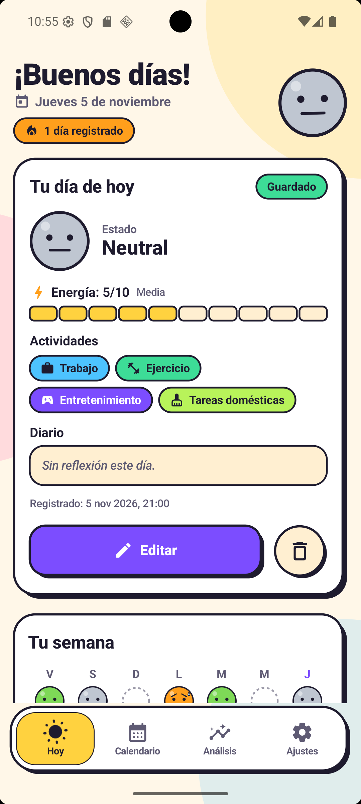
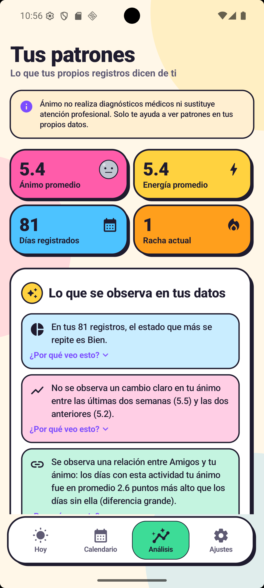
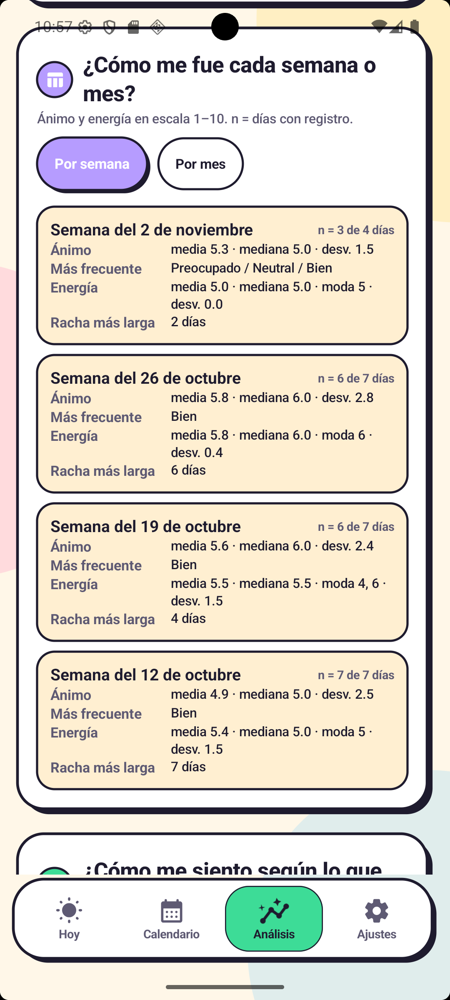

# Ánimo – Diario emocional (Etapa 2: "Descubre tus patrones")

Proyecto 2 · Programación de Dispositivos Móviles · UPIIT-IPN

> Ánimo no realiza diagnósticos médicos ni sustituye atención profesional.

## Descargas
- 📱 APK: [Releases](../../releases/latest)
- 🎬 Video del módulo de IA: [Releases](../../releases/latest)

## Capturas
| Hoy | Análisis | ¿Por qué veo esto? |
|---|---|---|
|  |  |  |

## Funcionalidades
- Nivel 1: estadísticas por semana y mes, tendencias de 7/30/90 días con media móvil, actividad vs. ánimo, …
- Nivel 3 (IA): módulo D – generación de insights en lenguaje natural (+ E, recomendaciones con IC 95 %)

## Decisiones técnicas
- **Método de correlación:** diferencia de medias + prueba de permutación + d de Cohen + Benjamini-Hochberg. Por qué: …
- **Umbrales:** 14 días en total y 5 registros por actividad.
- **Plantillas en vez de un modelo de lenguaje:** garantizan que no haya afirmaciones causales y funcionan sin conexión.
- **Almacenamiento:** JSON cifrado con AES-256-GCM y llave en el Keystore, en lugar de Room. Por qué: …
- **Privacidad:** todo el procesamiento es local.

## Cómo compilar
    ./gradlew assembleDebug
    ./gradlew test
